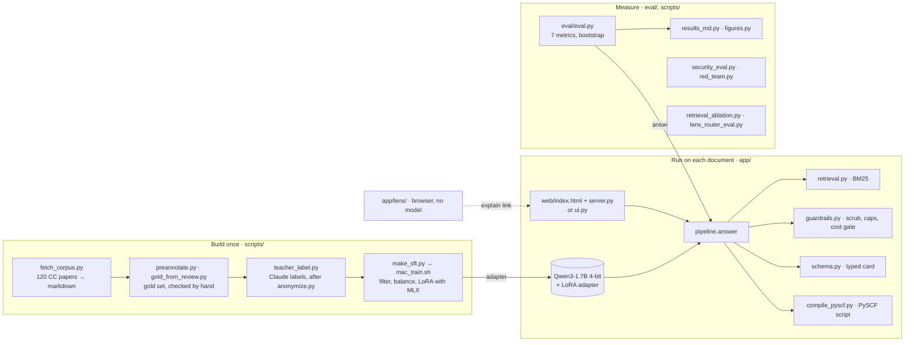

# Architecture

ReproChem reads a chemistry document and returns the seven settings of its
calculation (functional, basis set, dispersion, solvation, charge,
multiplicity, software), each with the sentence it was read from, or
`NOT_FOUND`. Everything runs on one laptop.

## Three lanes

Only the adapter crosses from the left lane to the middle one. The right lane
calls the same `answer()` the user calls, on papers the left lane never
trained on.

## What happens to one document

`app/pipeline.py`, function `answer()`:

| Step | Function | What it does |
|---|---|---|
| 1 | `parse` | cuts the markdown into sections, each split into windows of at most 200 words that keep the section title |
| 2 | `retrieve` | BM25 returns the 3 best passages for each of the 7 fields (`app/retrieval.py`) |
| 3 | `scrub` | removes hidden characters, fake chat turns and injected instructions from each passage (`app/guardrails.py`) |
| 4 | `extract` | one call to the student per field, on those 3 passages only; the answer is JSON: value, passage id, quote |
| 5 | `parse_field` | keeps the value only if it has a quote; checks the quote is in the passages and the value in the quote; otherwise `NOT_FOUND` or a warning |
| 6 | `compile_spec` | if functional, basis set, charge and multiplicity are all present and known, builds a typed `JobSpec` (`app/schema.py`) |
| 7 | `validate` | renders the PySCF script (`app/compile_pyscf.py`) and can run it on a small molecule |

Teacher, training set and student use the same `extract_messages()`, so the
student is trained on exactly the prompts it receives in production.

## Modules

| File | Role |
|---|---|
| `app/ingest.py` | converts docx, xlsx, ipynb and markdown into one markdown text |
| `app/retrieval.py` | BM25 (default), bge-m3 embeddings and their fusion, for comparison |
| `app/pipeline.py` | the steps above; model calls through MLX (Mac) or any OpenAI-compatible server |
| `app/guardrails.py` | injection filter, abstention, cost gate, Markdown escaping |
| `app/schema.py` | the method card and the job spec, with whitelists and bounds |
| `app/compile_pyscf.py` | the PySCF script template; values enter as quoted strings |
| `app/anonymize.py` | pseudonymises authors, e-mails, phones, ORCID and URLs before any API call |
| `app/server.py`, `app/web/` | the HTML app: one page, three tabs (extraction with its passages, Lens, attacks), local server on 127.0.0.1 |
| `app/ui.py` | the same extraction as a Streamlit page (fallback) |
| `app/lens/` | the voice explainer: `router.js` picks one of 10 hand-written concepts in `concepts.js`, `lens.js` draws and narrates it |
| `app/weight_edit.py` | optional experiment: a bias added to two layers to move the NOT_FOUND decision |
| `eval/eval.py`, `eval/compare.py` | scores a run on the gold set, with 95 % bootstrap intervals |

## Entry points

| Command | What it starts |
|---|---|
| `bash scripts/web.sh` | the HTML app (recommended) |
| `bash scripts/demo.sh` | the Streamlit page |
| `bash scripts/lens.sh` | Lens alone; `lens.sh voicetest.html` for the voice benchmark |
| `bash scripts/mac_train.sh` | trains the LoRA student |
| `bash scripts/mac_bench.sh` | full benchmark on the gold set |
| `uv run python scripts/security_eval.py` | the 20 attacks, without a model |

## Data: inputs and outputs

| Kind | Files |
|---|---|
| inputs, written or checked by people | `eval/testset.jsonl` (gold set), `data/gold_*.xlsx` (annotation sheets), `config.yaml`, `prompts/` |
| inputs, produced once | `data/teacher/` (Claude's 840 answers), `data/sft/` (510 training and 50 validation examples), `data/corpus_manifest.csv` |
| outputs, regenerated by scripts | `eval/report_*.json`, `docs/*.json`, `docs/*.md` result tables, `docs/figures/` |

The JSON outputs are machine-readable results: every field of every paper,
with scores and intervals. The markdown files next to them are the same results,
for people. The papers themselves are not in the repository: the manifest lists
them with their licence and checksum.

Design choices and the measurements behind them: [DECISIONS.md](DECISIONS.md).
Protections: [SAFEGUARDS.md](SAFEGUARDS.md).
